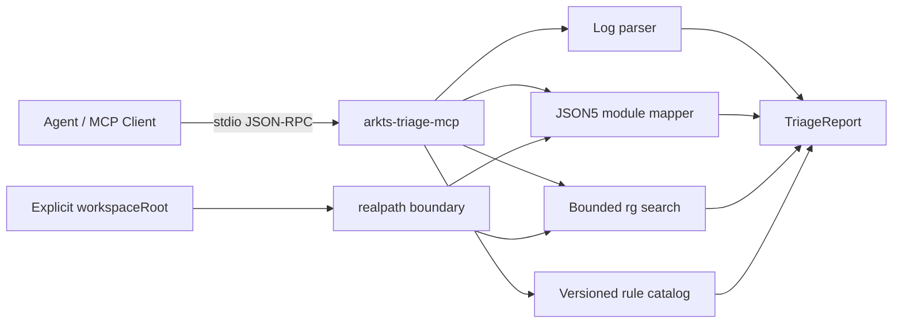

# arkts-triage-mcp

[](https://www.npmjs.com/package/arkts-triage-mcp)
[](https://github.com/97128785/arkts-triage-mcp/actions/workflows/ci.yml)
[](LICENSE)

[English](#english) | [中文](#中文)

面向 HarmonyOS / ArkTS 工程的本地 stdio MCP Server：把 Hvigor、ArkTS、ArkUI 和 Native loader 日志整理为可审查的“首个实质失败候选 + 有界证据 + 模块关系 + 下一步检查”。不调用模型 API，不执行构建，不修改业务代码。

## 中文

### 能做什么

| Tool                  | 输出                                                           |
| --------------------- | -------------------------------------------------------------- |
| `analyze_build_log`   | 首个实质失败候选、文件/行列、类别、诊断 ID、连锁错误、模块摘要 |
| `map_project_modules` | 从允许的 JSON5 元文件提取模块、依赖边和解析警告                |
| `trace_symbol`        | 用固定参数的 `rg` 返回有限的声明与引用位置                     |
| `explain_diagnostic`  | 从版本化本地规则目录返回适用条件、最小修复方向和待确认项       |

报告使用 `confidence`、`limitations` 和 `nextChecks`，不会把启发式结果包装成编译器已经证明的根因。

### 零配置 Quick Start

包已发布到 [npm](https://www.npmjs.com/package/arkts-triage-mcp)，MCP 客户端只需启动一个命令：

```sh
npx -y arkts-triage-mcp@latest
```

Claude Code 示例：

```sh
claude mcp add arkts-triage -- npx -y arkts-triage-mcp@latest
```

Cursor 或兼容 MCP 客户端：

```json
{
  "mcpServers": {
    "arkts-triage": {
      "command": "npx",
      "args": ["-y", "arkts-triage-mcp@latest"]
    }
  }
}
```

### 在 TraeCode 中添加

TraeCode 支持全局和项目级 MCP Server。推荐通过 **设置 > MCP > 添加 > 手动添加** 粘贴以下配置：

```json
{
  "mcpServers": {
    "arkts-triage": {
      "command": "npx",
      "args": ["-y", "arkts-triage-mcp@latest"]
    }
  }
}
```

也可以把配置加入 TraeCode 的全局 `mcp.json`。项目级配置写在可信项目根目录的 `.trae/mcp.json`，只对该项目生效。保存后确认 MCP 管理页显示 `arkts-triage`，并能列出四个 tools。详见 [TraeCode MCP 官方文档](https://docs.trae.cn/ide_add-mcp-servers)。

当前仓库本地运行：

```sh
npm install
npm run build
node dist/index.js
```

本地配置可将 `command` 设置为 `node`，`args` 设置为绝对路径 `/path/to/arkts-triage-mcp/dist/index.js`。stdio 模式等待 MCP 客户端输入，直接运行时没有普通终端输出属于正常行为。

### Inspector 与本地协议验证

```sh
npm run build
npx @modelcontextprotocol/inspector node dist/index.js
```

仓库也提供不依赖 Inspector UI 的真实 stdio 客户端调用：

```sh
npm run smoke
```

它会启动编译后的 server，列出四个 tools，并用匿名 fixture 调用 `analyze_build_log`。

### Tool 输入

```ts
analyze_build_log({
  logText: string,
  workspaceRoot?: string,
  maxEvidenceLines?: number // 1..30，默认 12
})

map_project_modules({ workspaceRoot: string })

trace_symbol({
  workspaceRoot: string,
  symbol: string,
  maxResults?: number // 1..30，默认 20
})

explain_diagnostic({
  diagnosticId?: string,
  errorText?: string
})
```

`analyze_build_log` 返回 `arkts-triage/v1` 报告。日志超过 1 MiB 时只保留脱敏后的首尾并声明限制；不会在结果中回传完整日志。

### 架构



详细设计见 [Architecture](docs/architecture.md)，规则范围见 [Supported diagnostics](docs/supported-diagnostics.md)。

### 隐私与安全边界

- 全部分析在本机完成；没有遥测、网络请求或模型 API。
- `workspaceRoot` 必须显式传入，路径经 `realpath` 后仍须位于根目录内。
- 不遍历 `node_modules`、`oh_modules`、`build`、`.hvigor`、`.git` 或目录 symlink。
- 只读取 `build-profile.json5`、`oh-package.json5`、锁文件摘要和 `src/main/module.json5`。
- `rg` 通过 `execFile` 参数数组执行，`shell: false`，符号按字面量匹配。
- 日志中的 token、password、Authorization、Cookie、client secret 和 API key 会被替换为 `[REDACTED]`。
- MCP 协议独占 stdout；启动错误只写 stderr。

### 限制

- 第一版不自动修改代码，不启动 Hvigor，不安装应用，不控制设备。
- 解析器维护多条确定性规则，但无法覆盖所有 Hvigor 与 SDK 版本的日志格式。
- 模块图来自静态元文件，不等价于 Hvigor 的最终解析结果。
- Native / Kotlin 线索只报告跨端候选；没有匹配源码、HAP、SO、ABI 和 BuildID 时不下确定结论。
- 规则目录提供修复方向，不替代当前 SDK 的官方 API 文档。

### 开发与贡献

要求 Node.js `>=20.19`，符号追踪还要求本机存在 `rg`。

```sh
npm ci
npm run check
npm run smoke
npm pack --dry-run
```

提交新诊断规则时必须同时提供：

1. 匿名化日志 fixture；
2. 对应的稳定 `expected.json`；
3. 一手技术参考；
4. 适用条件、最小修复方向和必须保留的未知项。

不要提交真实业务路径、凭据、用户数据、完整构建日志或生成目录。

完整流程见 [CONTRIBUTING.md](CONTRIBUTING.md)。安全问题请按 [SECURITY.md](SECURITY.md) 处理。

## English

`arkts-triage-mcp` is a local stdio MCP server for evidence-based HarmonyOS and ArkTS triage. It turns Hvigor, ArkTS, ArkUI, and native loader output into a reviewable first-failure candidate with bounded evidence. It does not call a model API, run a build, or edit source code.

### Tools

| Tool                  | Result                                                                                       |
| --------------------- | -------------------------------------------------------------------------------------------- |
| `analyze_build_log`   | First substantive failure candidate, source location, category, cascades, and module summary |
| `map_project_modules` | Modules, dependency edges, lockfile summary, and metadata warnings                           |
| `trace_symbol`        | Bounded literal symbol declarations and references from `rg`                                 |
| `explain_diagnostic`  | Maintained applicability, repair directions, unknowns, and references                        |

### Zero-configuration start

The package is available on [npm](https://www.npmjs.com/package/arkts-triage-mcp):

```sh
npx -y arkts-triage-mcp@latest
```

Compatible MCP client configuration:

```json
{
  "mcpServers": {
    "arkts-triage": {
      "command": "npx",
      "args": ["-y", "arkts-triage-mcp@latest"]
    }
  }
}
```

### Add to TraeCode

Open **Settings > MCP > Add > Add manually** and paste:

```json
{
  "mcpServers": {
    "arkts-triage": {
      "command": "npx",
      "args": ["-y", "arkts-triage-mcp@latest"]
    }
  }
}
```

TraeCode also loads trusted project-level configuration from `.trae/mcp.json`. See the [official TraeCode MCP documentation](https://docs.trae.cn/ide_add-mcp-servers).

For a local checkout:

```sh
npm install
npm run build
npm run smoke
```

### Design

The server uses the stable `@modelcontextprotocol/sdk` v1 stdio transport and Zod validation. Parsing, redaction, candidate selection, catalog matching, and module extraction are deterministic. Workspace access is constrained by `realpath`, and symbol search uses argument-array process execution with fixed source globs.

The returned candidate is not called a root cause. Reports explicitly separate confidence, limitations, and next checks so an agent can trace:

```text
entry -> parameters/state -> bridge -> output
```

Use the bundled [`arkts-triage` Agent Skill](skills/arkts-triage/SKILL.md) to enforce that workflow and distinguish `confirmed`, `inferred`, and `unknown` statements.

### Privacy

- Local processing only; no telemetry or remote model calls.
- No full-log echo.
- Credential-like values are redacted before evidence is returned.
- No traversal outside the explicit workspace root.
- Generated and dependency directories are excluded.
- stdout is reserved for MCP protocol messages.

### Limitations

- No automatic fixes, builds, device operations, or package installation.
- Static metadata does not reproduce the complete Hvigor resolver.
- Unknown diagnostics remain `unclassified`.
- Native and cross-language failures require matching artifacts before ownership can be confirmed.

### Contributing

Run:

```sh
npm ci
npm run check
npm run smoke
npm pack --dry-run
```

Every new catalog rule needs an anonymous fixture, stable expected JSON, a primary reference, explicit applicability, bounded repair directions, and unresolved questions. Never commit credentials, private source paths, complete production logs, or generated dependency trees.

See [CONTRIBUTING.md](CONTRIBUTING.md) for the complete workflow and [SECURITY.md](SECURITY.md) for vulnerability reporting.

## License

MIT
