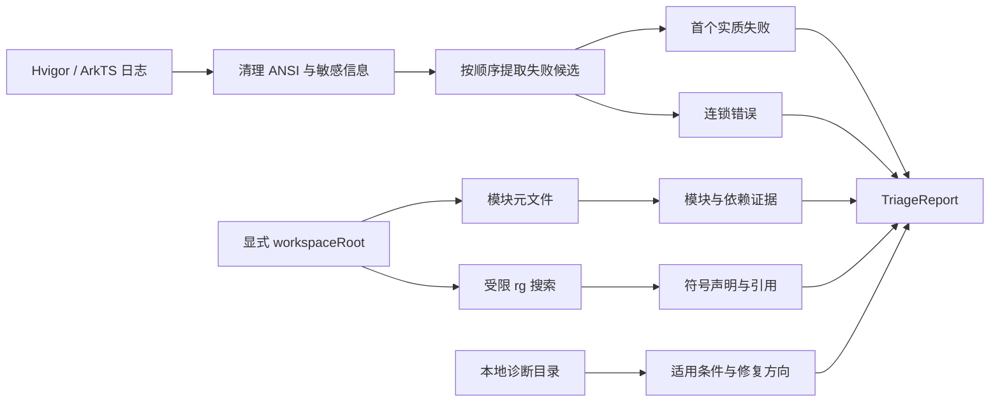

<div align="center">

[English](#english) · **简体中文**

# arkts-triage-mcp

### 从 Hvigor 构建日志中找到第一个真正值得修复的错误。

**本地运行、证据优先、不会执行构建，也不会修改你的代码。**

[](https://www.npmjs.com/package/arkts-triage-mcp)
[](https://github.com/97128785/arkts-triage-mcp/actions/workflows/ci.yml)
[](#工具目录)
[](#运行要求)
[](LICENSE)

**[快速开始](#快速开始) · [工作原理](#工作原理) · [可以诊断什么](#可以诊断什么) · [调用示例](#调用示例) · [常见问题](#常见问题) · [文档](#文档)**

<code>npx -y arkts-triage-mcp@latest</code>

</div>

> [!IMPORTANT]
> 官方来源只有 [GitHub 仓库](https://github.com/97128785/arkts-triage-mcp) 和 [npm 包](https://www.npmjs.com/package/arkts-triage-mcp)。请从这两个地址获取代码和发布版本。

---

Hvigor 日志通常同时包含编译器诊断、任务摘要、守护进程信息和大量后续错误。最终的 `BUILD FAILED` 说明构建失败了，却没有说明最早在哪里破坏了约束。

`arkts-triage-mcp` 把这段机械工作交给本地 MCP Server：

- 按日志顺序寻找首个有文件、行号、诊断 ID 或明确类别的失败候选；
- 忽略通常只是结果的 `BUILD FAILED`、任务汇总和守护进程退出信息；
- 将后续错误标记为可能的连锁错误；
- 从 HarmonyOS 元文件中补充模块和依赖证据；
- 用受限的 `rg` 搜索符号声明与引用；
- 根据本地版本化规则目录解释常见 ArkTS、ArkUI、模块、权限和 Native loader 诊断。

返回结果包含 `confidence`、`limitations` 和 `nextChecks`。它不会把启发式结果伪装成编译器已经证明的根因。

## 快速开始

### 1. 添加 MCP Server

任何支持本地 stdio MCP 的客户端都可以使用：

```json
{
  "mcpServers": {
    "arkts-triage": {
      "command": "npx",
      "args": ["-y", "arkts-triage-mcp@latest"]
    }
  }
}
```

### 2. 在 TraeCode 中启用

打开 **设置 > MCP > 添加 > 手动添加**，粘贴上面的 JSON。

项目级配置可以写入可信项目根目录的 `.trae/mcp.json`。保存后确认 MCP 管理页显示 `arkts-triage`，并能列出四个 tools。详见 [TraeCode MCP 官方文档](https://docs.trae.cn/ide_add-mcp-servers)。

### 3. 询问智能体

```text
调用 arkts-triage 分析下面的 Hvigor 日志。
请先找首个实质失败，再确认所属模块和相关符号，不要把 BUILD FAILED 当成根因。

workspaceRoot: /absolute/path/to/harmony-project

<粘贴日志>
```

也可以让智能体读取已有日志文件，再把日志文本传给 `analyze_build_log`：

```text
读取 /absolute/path/to/build.log，
使用 arkts-triage 按 analyze_build_log -> map_project_modules
-> trace_symbol -> explain_diagnostic 的顺序排查。
```

> [!NOTE]
> `analyze_build_log` 接收的是日志文本，不是日志文件路径。读取文件由 MCP 客户端或智能体完成。

## 工作原理



所有分析都在本机完成。MCP 只消费用户提供的日志和显式工作区，不启动 Hvigor、不安装应用、不控制设备、不调用模型 API。

## 可以诊断什么

| 类别        | 典型信号                               | 返回的证据                                           |
| ----------- | -------------------------------------- | ---------------------------------------------------- |
| ArkTS 类型  | 类型不兼容、属性不存在、名称无法解析   | 文件、行列、诊断 ID、类型边界检查方向                |
| ArkUI 状态  | 状态所有权、非法写入、对象变更未被观察 | 组件位置、状态类别、所有权与更新链检查               |
| 模块依赖    | `Cannot find module`、未声明依赖       | 导入位置、模块清单、依赖边、锁文件摘要               |
| 权限        | `module.json5` 未声明、运行时权限拒绝  | 权限类别、模块配置位置、声明与授权检查               |
| Native load | `dlopen failed`、`undefined symbol`    | 首个 loader 错误、后续桥接失败、ABI/BuildID 检查方向 |

内置匿名 fixture 覆盖以上五类问题。完整规则范围见 [Supported Diagnostics](docs/supported-diagnostics.md)。

## 工具目录

| Tool                  | 什么时候使用                             | 主要输出                                           |
| --------------------- | ---------------------------------------- | -------------------------------------------------- |
| `analyze_build_log`   | 已有 Hvigor、ArkTS、ArkUI 或 loader 日志 | 首个失败候选、证据上下文、连锁错误、置信度和下一步 |
| `map_project_modules` | 需要确认错误属于哪个模块或依赖关系       | 模块、声明关系、依赖边、锁文件摘要和解析警告       |
| `trace_symbol`        | 日志或源码中出现明确符号                 | `.ets`、`.ts`、`.json5` 中有限的声明和引用位置     |
| `explain_diagnostic`  | 已有诊断 ID 或稳定错误文本               | 适用条件、规则摘要、最小修复方向、未知项和参考链接 |

### `analyze_build_log`

```ts
analyze_build_log({
  logText: string,
  workspaceRoot?: string,
  maxEvidenceLines?: number // 默认 12，最大 30
})
```

日志超过 1 MiB 时，只保留脱敏后的首尾并在 `limitations` 中声明截断。完整日志不会原样返回。

### `map_project_modules`

```ts
map_project_modules({
  workspaceRoot: string,
});
```

只读取以下元文件：

- 根目录 `build-profile.json5`；
- 根目录或模块目录中的 `oh-package.json5`；
- 根目录 `oh-package-lock.json5` 的摘要；
- 模块 `src/main/module.json5`。

### `trace_symbol`

```ts
trace_symbol({
  workspaceRoot: string,
  symbol: string,
  maxResults?: number // 默认 20，最大 30
})
```

符号按字面量匹配。`rg` 通过参数数组和 `shell: false` 执行，不扫描 `node_modules`、`oh_modules`、`build`、`.hvigor` 或 `.git`。

### `explain_diagnostic`

```ts
explain_diagnostic({
  diagnosticId?: string,
  errorText?: string
})
```

精确诊断 ID 优先于受维护的文本规则。没有匹配时返回 `unclassified`，保留未知项，而不是猜测替代 API。

## 调用示例

### 只分析日志

```text
调用 analyze_build_log 分析以下日志。
只报告首个实质失败、最多 12 行证据和后续连锁错误：

<粘贴日志>
```

### 定位模块依赖

```text
调用 map_project_modules，
分析 /absolute/path/to/harmony-project 的模块和依赖关系。
重点检查 entry 是否声明了 @sample/media-kit。
```

### 追踪符号

```text
调用 trace_symbol，
在 /absolute/path/to/harmony-project 中搜索 TimelineStore，
区分声明和引用，最多返回 20 条。
```

### 完整排障

```text
使用 arkts-triage 按以下顺序排查：

1. analyze_build_log 找首个实质失败；
2. map_project_modules 确认所属模块；
3. trace_symbol 追踪证据中的符号；
4. explain_diagnostic 给出规则依据和最小修复方向。

所有结论区分 confirmed、inferred 和 unknown。
```

### 报告示例

```json
{
  "schemaVersion": "arkts-triage/v1",
  "status": "diagnosed",
  "summary": "First substantive arkts failure candidate at entry/src/main/ets/pages/Index.ets:12:9.",
  "confidence": "high",
  "firstFailure": {
    "kind": "arkts",
    "file": "entry/src/main/ets/pages/Index.ets",
    "line": 12,
    "column": 9,
    "diagnosticId": "ARKTS_TYPE_ASSIGNMENT",
    "evidence": []
  },
  "cascadeErrors": [],
  "modules": [],
  "nextChecks": [],
  "limitations": []
}
```

## 其他客户端

### Claude Code

```sh
claude mcp add arkts-triage -- npx -y arkts-triage-mcp@latest
```

### Cursor 与兼容客户端

把[快速开始](#快速开始)中的 `mcpServers` 配置加入客户端的 MCP 配置文件。

### MCP Inspector

在源码仓库中：

```sh
npm ci
npm run build
npx @modelcontextprotocol/inspector node dist/index.js
```

## 运行要求

- Node.js `>=20.19.0`；
- npm；
- `rg`，仅 `trace_symbol` 需要。

不需要 HarmonyOS SDK、DevEco Studio、设备或模型 API Key。

## 隐私与安全

- 日志、源码和元数据不会由本项目上传到网络；
- `workspaceRoot` 先经过 `realpath`，每次元文件读取再次验证边界；
- 不跟随目录 symlink 扫描工作区外部内容；
- token、password、Authorization、Cookie、client secret 和 API key 会替换为 `[REDACTED]`；
- stdout 只用于 MCP JSON-RPC，启动错误写入 stderr；
- 结果有数量、行数和上下文长度限制。

详细信任模型见 [Architecture](docs/architecture.md)。安全问题请使用 GitHub 的[私密漏洞报告](https://github.com/97128785/arkts-triage-mcp/security/advisories/new)，不要在公开 issue 中提交真实日志或凭据。

## 限制

- 不自动修改代码或承诺自动修复；
- 不执行 Hvigor、Gradle、安装、真机或网络操作；
- 静态模块图不等价于 Hvigor 最终依赖解析结果；
- 未识别的日志格式会降级为 `insufficientEvidence` 或 `unclassified`；
- Native、Kotlin 和跨端问题需要匹配源码与 HAP/SO/BuildID 才能确认归属；
- 规则目录提供检查方向，不替代当前 SDK 的官方 API 文档。

## 常见问题

<details>
<summary><strong>它会直接告诉我根因吗？</strong></summary>

不会。它返回首个实质失败候选、证据、置信度、限制和下一步检查。根因仍需由同一次构建日志、匹配源码和必要的运行或产物证据确认。

</details>

<details>
<summary><strong>为什么结果是 insufficientEvidence？</strong></summary>

日志中可能只有 `BUILD FAILED` 或任务汇总，没有文件、行号、诊断 ID 或可分类错误。请提供第一个 `ERROR` 前后约 20 行日志。

</details>

<details>
<summary><strong>为什么 trace_symbol 返回 RG_NOT_FOUND？</strong></summary>

`trace_symbol` 依赖本机的 ripgrep。安装 `rg` 后重试；服务不会自动安装系统工具。

</details>

<details>
<summary><strong>它会扫描 oh_modules 或 build 吗？</strong></summary>

不会。`node_modules`、`oh_modules`、`build`、`.hvigor` 和 `.git` 都在固定排除列表中。

</details>

<details>
<summary><strong>能分析 Native 或 Kotlin 错误吗？</strong></summary>

能识别 Native loader 和跨端候选，但不会在缺少匹配源码、ABI、BuildID 或产物证据时编造内部根因。

</details>

<details>
<summary><strong>它会上传项目或日志吗？</strong></summary>

不会。服务是本地 stdio 进程，没有遥测和模型 API。MCP 客户端及其模型提供商有各自的数据政策，请同时检查客户端配置。

</details>

## 本地开发

```sh
git clone https://github.com/97128785/arkts-triage-mcp.git
cd arkts-triage-mcp
npm ci
npm run check
npm run smoke
npm pack --dry-run
```

新增或修改诊断规则时，必须同时提供匿名日志 fixture、稳定 `expected.json`、一手技术参考、适用条件、修复方向和必须保留的未知项。

## 文档

- [Architecture](docs/architecture.md)：组件边界、信任模型和日志选择规则；
- [Supported Diagnostics](docs/supported-diagnostics.md)：当前维护的诊断 ID 与规则政策；
- [Agent Skill](skills/arkts-triage/SKILL.md)：入口到输出的证据追踪工作流；
- [Contributing](CONTRIBUTING.md)：开发、测试和 Pull Request 要求；
- [Security Policy](SECURITY.md)：安全边界和漏洞报告；
- [Changelog](CHANGELOG.md)：版本变更记录；
- [GitHub Releases](https://github.com/97128785/arkts-triage-mcp/releases)：发布说明。

## English

`arkts-triage-mcp` is a local stdio MCP server that turns Hvigor, ArkTS, ArkUI, and native loader logs into a reviewable first-failure candidate with bounded evidence.

It provides four deterministic tools:

- `analyze_build_log` selects the earliest substantive failure and separates cascades;
- `map_project_modules` reads allowed HarmonyOS JSON5 metadata;
- `trace_symbol` performs bounded literal `rg` searches;
- `explain_diagnostic` uses a versioned local catalog.

Add it to any compatible MCP client:

```json
{
  "mcpServers": {
    "arkts-triage": {
      "command": "npx",
      "args": ["-y", "arkts-triage-mcp@latest"]
    }
  }
}
```

The server runs locally, does not call a model API, does not execute builds, and does not modify source code. See [Architecture](docs/architecture.md), [Supported Diagnostics](docs/supported-diagnostics.md), and [Contributing](CONTRIBUTING.md) for details.

## License

[MIT](LICENSE)
