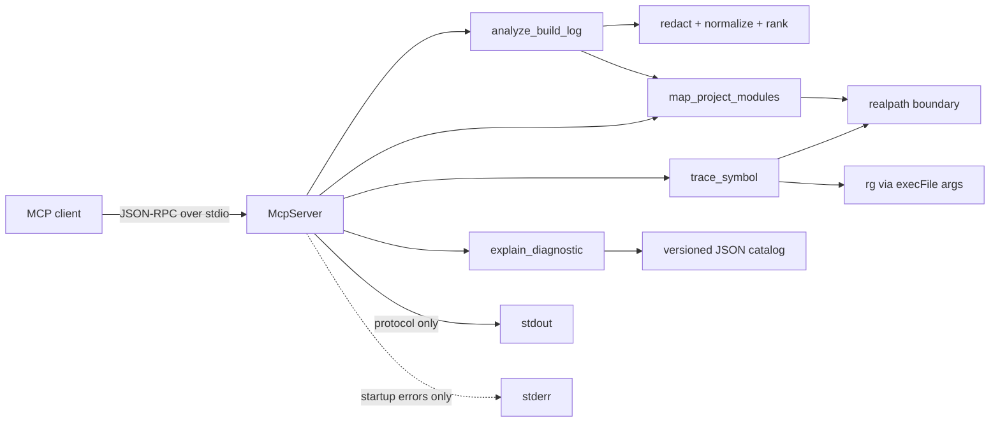

# Architecture

`arkts-triage-mcp` is a local stdio MCP server. It does not run builds, contact model APIs, or edit the analyzed workspace.

## Boundaries

- `src/domain`: stable report and workspace contracts.
- `src/infra`: redaction, `realpath` checks, JSON5 reads, and shell-free process execution.
- `src/tools`: deterministic tool behavior with no model dependency.
- `src/catalog`: maintained diagnostic rules and primary references.
- `src/server.ts`: Zod-validated MCP registration and JSON serialization.

## Trust Model

1. A supplied `workspaceRoot` is resolved with `realpath`.
2. Every metadata read is resolved again and must remain within that root.
3. Directory symlinks are not traversed during metadata discovery.
4. `node_modules`, `oh_modules`, `build`, `.hvigor`, and `.git` are excluded.
5. Symbol search uses `execFile("rg", args)` with `shell: false`, literal matching, fixed globs, and bounded output.
6. Logs are ANSI-normalized and redacted before evidence is returned.
7. Reports describe candidates, confidence, limitations, and next checks; they do not claim a compiler-proven root cause.

## Log Selection

The parser keeps log order. It ignores common terminal summaries such as `BUILD FAILED`, then selects the first line with at least one concrete signal:

- source file and line;
- maintained diagnostic ID; or
- classified ArkTS, ArkUI, module, permission, or native failure text.

Later concrete failures become `cascadeErrors`. Context is line-bounded, and the complete log is never echoed.

## Module Mapping

Only these metadata shapes are considered:

- root `build-profile.json5`;
- root or nested `oh-package.json5`;
- root `oh-package-lock.json5` as a package-count summary;
- nested `src/main/module.json5`.

Module relationships come from declared `srcPath` entries, package names, and dependency specifiers. The output is evidence for triage, not a replacement for Hvigor's effective dependency resolver.
